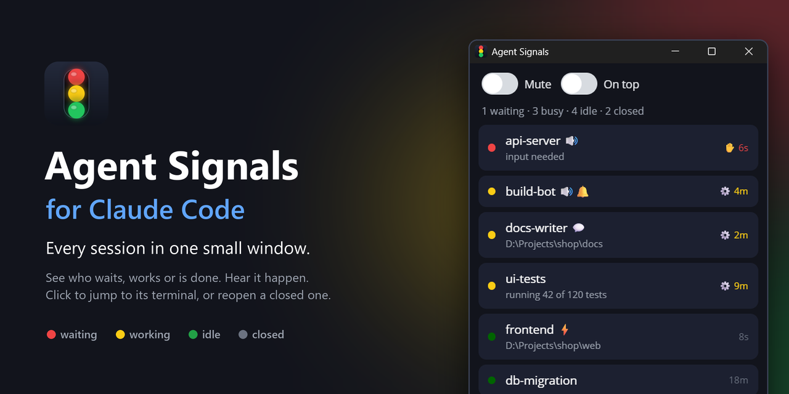
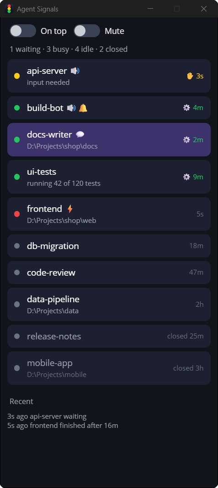

**Agent Signals for Claude Code**: a small app for Windows and macOS that shows all your Claude
Code sessions in one window and tells you when one finishes or needs you.

If you have dozens of terminals open, each with a Claude Code agent at work, you know the problem:
which one is done, which one is waiting for your answer, and which one is still busy? Agent Signals
puts all of them in one small window and tells you when something happens, so you stop cycling
through tabs to find out.

- **See every session at a glance**: yellow is waiting for you, green is working, red has just
  finished, gray is free.
- **Know when one finishes**: right-click a session and turn on what you want: a spoken
  "api-server finished", a sound, a notification, a flashing taskbar or Dock icon.
- **Jump to it**: click a session to bring its terminal tab to the front.
- **Get them back after a reboot**: one click reopens every session that was open, with its
  conversation, in its terminal.

Nothing to configure in Claude Code: the app reads the list of sessions Claude Code already keeps.
Windows and macOS, written in Rust, its UI drawn with [DrawnUi.Rust](https://github.com/DrawnUi/DrawnUi.Rust).



## The window

**Top bar**

- **On top**: keeps the window above all other windows, so it stays visible while you work in the
  terminals.
- **Mute**: silences every signal until you switch it off, for example during a call. Status
  changes are still listed under Recent.
- **Counts**: how many sessions are waiting for you, working, and idle.

**After a reboot** the list starts with "20 sessions from last time are closed" and their names.
**Reopen 20 sessions from last time** reopens each one with `claude --resume`: its conversation,
its start folder, its permission mode and its name, a few seconds apart. On Windows they come back
in Windows Terminal, grouped into windows and tabs as they were; on macOS each in a Terminal window
of its own. **Not now** hides the offer; they stay in the list as closed sessions. A reopened session waits for you;
it does not continue interrupted work by itself.

### Sessions started in your home folder

Claude Code never saves trust for the home folder, so a session started there asks "trust this
folder?" every time it opens, also when it is reopened. Start agents in a folder of their own
instead, for example `%USERPROFILE%\Agents` (Windows) or `~/Agents` (macOS); it asks once and
stays trusted. To keep the memory your agents built in the home folder, give that folder a
`.claude/settings.local.json` with

```json
{ "autoMemoryDirectory": "~/.claude/projects/C--Users-<you>/memory" }
```

(on macOS `-Users-<you>` in place of `C--Users-<you>`)

(the memory folder of your home folder; Claude Code reads this setting only from local or user
settings). Conversations started in the home folder resume from the new folder without trouble.
To have Agent Signals reopen them there too, set `"reopen_home_in"` to that folder in the app's
`sessions.json` while the app is closed (`"C:\\Users\\<you>\\Agents"` in
`%APPDATA%\AgentSignals\sessions.json` on Windows, `"/Users/<you>/Agents"` in
`~/Library/Application Support/AgentSignals/sessions.json` on macOS).

**One row per Claude Code session**, in this order: waiting for you first, then working, then idle
with the one that finished last on top, then closed with the one closed last on top.

- **Click** a row: its terminal tab comes to the front. Click a closed (gray) row and it opens
  again in the terminal, with its conversation.
- **Right-click** a row (or the Menu key):
  - **📋 Copy name**: the session's name, to paste into a message to it or to another agent.
  - **🔊 Announce when finished**: the app says "<name> finished" every time it finishes.
  - **🔔 Play a sound when finished**: a short sound (tada on Windows, Glass on macOS).
  - **💬 Notify when finished**: a notification "<name> finished". Click it and the session's
    terminal tab comes to the front, as with a click on its row.
  - **⚡ Flash taskbar when finished**: on Windows the session's terminal window flashes on the
    taskbar until you switch to it (taskbar buttons are usually grouped, so the Windows Terminal
    button flashes: hover it to see which window). On macOS Agent Signals' own Dock icon bounces.
  - **🎨 Tint**: opens a palette next to the menu; the color you pick tints the session's row (None
    takes it off). Tints are kept by session name, so a reopened session or a new one with the same
    name gets it back.
  - **❌ Close session**: closes its terminal tab after you confirm. Claude ends there; the session
    stays in the list, gray, and a click reopens it.

  Each signal item turns into "Stop ..." once it is on; choose it again to turn it off.

  On a closed session the menu has **📋 Copy name**, **🔄 Reopen**, **🎨 Tint** and **🗑 Remove** (takes it off the list;
  the conversation itself stays, `claude --resume` still finds it).

**Closed sessions** stay in the list when you close their terminal, until you remove them. Only
sessions that run in a terminal are kept, and only once they have a conversation (a session closed
before its first message has nothing to reopen).

**Finished while you looked elsewhere**: a session that finishes while its terminal tab is not the one
in front gets a red dot, so you see what is new. It turns gray when you click the row, switch to its
tab yourself, or the session starts working again.

**Recent**: the last status changes ("frontend finished after 17m") and which signals they gave.

The list scrolls when it is longer than the window; the bar on the right shows where you are.

### What the colors and icons mean

| On a row | Meaning |
|---|---|
| 🟡 yellow dot | The session waits for you: a question, a permission dialog. |
| 🟢 green dot | The session is working. |
| 🔴 red dot | It finished while you were not looking at its terminal tab: new for you. |
| ⚪ gray dot | The session is idle: it finished and has nothing to do. |
| ⚪ gray dot, gray name, "closed 2h" | The session is closed: its terminal is gone. Click to reopen it. |
| ✋ 1m | Waiting for you, for 1 minute so far. |
| ⚙ 4m | Working, for 4 minutes so far. |
| 18m (no icon) | Idle, finished 18 minutes ago. |
| 🔊 after the name | You will hear "<name> finished". |
| 🔔 after the name | You will hear a sound when it finishes. |
| 💬 after the name | You will get a notification when it finishes. |
| ⚡ after the name | Its terminal flashes on the taskbar (Agent Signals bounces in the Dock on macOS) when it finishes. |
| Line under the name | What it waits for ("input needed"), a status line an agent posted there (see API), or its project folder. |

| In the menu | Meaning |
|---|---|
| 🔇 Stop announcing | Announcing is on for this session; choose it to turn it off. |
| 🔕 Stop the sound | The sound is on; choose it to turn it off. |
| 💬 Stop notifying | Notifications are on; choose it to turn them off. |
| ⚡ Stop flashing | Flashing is on; choose it to turn it off. |

## Under the hood

- **Sessions** come from Claude Code's own registry, `~/.claude/sessions/<pid>.json` (name, `busy`
  / `idle` / `waiting`). No hooks, nothing to configure in Claude Code.
- **Events**: `started`, `finished` (busy to idle), `waiting` (needs input, dialog open), `closed`.
- **Rules** say which event of which session gives which signal. The menu's signal items make them;
  they persist in the app's folder: `%APPDATA%\AgentSignals` on Windows,
  `~/Library/Application Support/AgentSignals` on macOS.
- **Optional, for agents**: a local API (below) lets Claude agents add rules (also for `waiting`,
  `started`, `closed`), signal right away, or post a status line under a session.

Windows 10 or 11 with Claude Code installed (any installer: native or npm). Selecting, closing and
reopening terminal tabs needs Windows Terminal; the list and the signals work with any terminal.
On macOS the same, with Terminal.app in that part: see [macOS](#macos) for its folders and the two
permissions it asks for.

## Download

[Releases](https://github.com/taublast/AgentSignals/releases) have both downloads. Prefer to build
it yourself? Read on.

**Windows**: `agentsignals-<version>-windows-x64.exe` (most PCs) or `-windows-arm64.exe` (ARM
laptops such as Snapdragon), one file, no installer, run it from any folder. It is not
code-signed, so Windows SmartScreen asks once: **More info**, then **Run anyway**.

**Mac**: `AgentSignals-<version>-macos-universal.zip`, one build for Apple silicon and Intel. Unzip
it and move **Agent Signals.app** to Applications. It is signed and notarized, so it opens with no
warning; the first time it needs something, macOS asks for notifications and for permission to
control Terminal (see [macOS](#macos)).

## Build and run

On Windows as below; on macOS see [macOS](#macos).

1. Check the tools:
   ```powershell
   rustc --version     # 1.85 or newer (built with 1.94)
   ```
   Missing? Install Rust and the Microsoft C++ build tools it links with:
   ```powershell
   winget install Rustlang.Rustup
   winget install Microsoft.VisualStudio.2022.BuildTools --override "--wait --quiet --add Microsoft.VisualStudio.Workload.VCTools --includeRecommended"
   ```
2. Build and start it from the repository folder:
   ```powershell
   cargo build --release
   Start-Process .\target\release\agentsignals.exe
   ```
   The first build takes a few minutes: it downloads Skia prebuilt for the drawnui crate. Later
   builds take seconds. Starting it a second time flashes the running one instead.
3. For the release files: `dev\release.ps1` builds `target\dist\agentsignals-<version>-windows-x64.exe`
   and `-arm64.exe` with local folder paths remapped out of the binary, and fails if any is left.
   ARM64 is cross-built and needs Visual Studio's "MSVC ARM64 build tools"
   (`dev\release.ps1 -Arch x64` builds x64 only).
4. To check a build the way a new machine meets it, with the app closed: `dev\machine-test.ps1`
   (or `dev\machine-test.ps1 target\dist\agentsignals-<version>-windows-x64.exe`). It starts the app on a fresh
   empty profile, starts it twice, starts it while another program holds its port (an error
   message must show), then runs the unit tests and a live Windows Terminal test that opens one tab
   and closes it.

### Code layout

Everything that differs per operating system is in `src/platform/`, one file per system
(`windows.rs`, `macos.rs`); `src/platform/mod.rs` lists what each one provides. The window, the session
list, rules, signals logic, the API and the session memory are shared and never call the system
directly.

### Start with Windows (optional)

The app then starts when you sign in, so after a reboot it offers your sessions from last time
right away. From the repository folder:

```powershell
$lnk = (New-Object -ComObject WScript.Shell).CreateShortcut("$env:APPDATA\Microsoft\Windows\Start Menu\Programs\Startup\Agent Signals.lnk")
$lnk.TargetPath = "$PWD\target\release\agentsignals.exe"; $lnk.WorkingDirectory = "$PWD\target\release"; $lnk.Save()
```

## macOS

Claude Code installed (native installer or Homebrew) and Terminal.app. The session list and the
signals work with any terminal; selecting, closing and reopening tabs is Terminal.app only.

Build and run it from the repository folder:

```sh
cargo build --release
./target/release/agentsignals
```

Run this way it is a bare program, not an app: macOS shows its notifications under the system's
script tool, and a click on one only dismisses it. The download, a real app, does both properly.
`dev/release.sh` builds that app: universal (Apple silicon and Intel), signed and notarized when
Xcode is signed in to an Apple developer account, ad-hoc signed for local use otherwise.

The first launch of the download asks macOS for permission to open it; the app's window appears
once that is answered. Two more permissions are asked for the first time they are needed, both
under **System Settings > Privacy & Security**:

- **Automation > Terminal** — for clicking a row (focus its tab), Close session, and reopening a
  session. Refused, those say so under Recent instead of failing quietly; the list and every signal
  keep working. You can grant it later.
- **Notifications** — for the notification signal; they show under Agent Signals' name.

What differs from Windows:

- **Sounds** come from `/System/Library/Sounds` and `~/Library/Sounds` (`.aiff`, `.wav`); the
  finished sound is `Glass`. Sounds and speech share one queue, so two signals at once are heard
  one after the other, as they are on Windows.
- **Flash** always bounces Agent Signals' own Dock icon, never the terminal's: one application
  cannot make another's icon jump. Recent says `flash app` for it.
- **Reopening a session** opens a Terminal **window** of its own, not a tab beside the others:
  putting a tab in a chosen window needs keystroke injection (Accessibility permission), and aimed
  at the wrong window it would open a tab in one of yours.
- **Close session** ends the session's shell, which ends Claude Code in it, and then closes its
  window. Terminal.app's scripting cannot close a single tab, so a session sharing a window with
  other tabs leaves its tab behind, emptied.
- Files live in `~/Library/Application Support/AgentSignals`, and the sessions are read from
  `~/.claude/sessions/<pid>.json`.

## Set up with Claude

Your Claude Code agent can build and start the app for you. Tell it:

```
Set up Agent Signals from https://github.com/taublast/AgentSignals: clone it, follow the README's
Build and run section, start the app, then install skill/agent-signals as my personal skill.
```

It installs the skill by copying `skill/agent-signals` to `~/.claude/skills/agent-signals`
and writing the clone's folder in place of `<app-folder>` in its `SKILL.md`. The skill is optional:
it lets agents use the API, for example to add a rule when you ask "tell me when any agent needs me".

## API

Optional, for Claude agents and scripts: `http://127.0.0.1:47801`; `GET /` prints this list.

| Call | Body | |
|---|---|---|
| `GET /sessions` | | live sessions: name, pid, status, waiting_for, title, since_ms, cwd, note |
| `GET /rules` | | rules |
| `POST /rules` | `{session, on, sound?, say?, toast?, title?, flash?, raise?, once?, min_busy_s?}` | `session` a name or `*`; `on` finished, waiting, started, closed |
| `DELETE /rules/<id>` | | |
| `POST /signal` | `{sound?, say?, toast?, title?, flash?, raise?, session?}` | signal now |
| `POST /note` | `{session, text}` | a line under the session (empty clears) |
| `GET /tints` | | session rows' tint colors |
| `POST /tint` | `{session, color}` | tint the session's row, `color` as `#RRGGBB` (empty clears) |
| `POST /focus` | `{session}` | select its terminal tab |
| `GET /events` | | last 50 events and what fired |
| `GET /sounds` | | playable sound names |

`flash` flashes the session's terminal window (Agent Signals itself when there is no session, the
session is in a terminal the app does not control, or on macOS); `raise` brings Agent Signals
forward. Text fields take `{name}` and `{waiting}`. Sounds: a name from `GET /sounds` (the app's
`sounds` folder, then the system sounds: `C:\Windows\Media` on Windows, `/System/Library/Sounds`
on macOS) or a full path to a sound file. Sounds and speech share one queue, so signals never
overlap.

```powershell
$r = @{ session = "api-server"; on = "finished"; sound = "tada"; say = "{name} finished" } | ConvertTo-Json
Invoke-RestMethod -Method Post http://127.0.0.1:47801/rules -Body $r -ContentType application/json
```

```sh
curl -s http://127.0.0.1:47801/rules -d '{"session":"api-server","on":"finished","sound":"Glass","say":"{name} finished"}'
```

Localhost only, no authentication: any local process can make it beep.

## Notes

- The session file format is Claude Code's internal one (seen on 2.1.287 to 2.1.309); missing fields are tolerated.
- A session with no name of its own (`dev-3f`) shows its custom or AI title in the terminal tab; the app
  reads that title from the transcript tail to find the tab.
- Windows: a notification needs the per-user AUMID `AgentSignals`, registered on start under
  `HKCU\Software\Classes\AppUserModelId\AgentSignals`.
- A session that cannot be reopened (Claude Code or the terminal not found) shows under Recent
  as "not reopened" with the reason. A start folder that no longer exists reopens in your home
  folder (or `reopen_home_in`).
- API `raise` on Windows: Windows may refuse to bring a window forward from the background; the
  taskbar button flashes instead.

## What it reads and writes

- Reads `~/.claude/sessions/*.json` (Claude Code's list of live sessions) and, from
  each session's transcript, its first lines (start folder), its last lines (permission mode) and,
  for a session without a name of its own, its title.
- Writes `rules.json`, `settings.json` (row tints), `sessions.json` (the terminal sessions; closed ones stay until you remove
  them) and, after a crash, `crash.log` in its folder (`%APPDATA%\AgentSignals` on Windows,
  `~/Library/Application Support/AgentSignals` on macOS). On Windows it registers the notification
  AUMID under `HKCU\Software\Classes\AppUserModelId\AgentSignals`.
- Starts a terminal only when you reopen sessions: `wt` on Windows, Terminal.app on macOS.
- Sends nothing anywhere: the API listens on 127.0.0.1 only.

## License

MIT, see [LICENSE](LICENSE). Open Sans (`assets/OpenSans-Regular.ttf`) is under the Apache License 2.0,
see [assets/OpenSans-LICENSE.txt](assets/OpenSans-LICENSE.txt).
